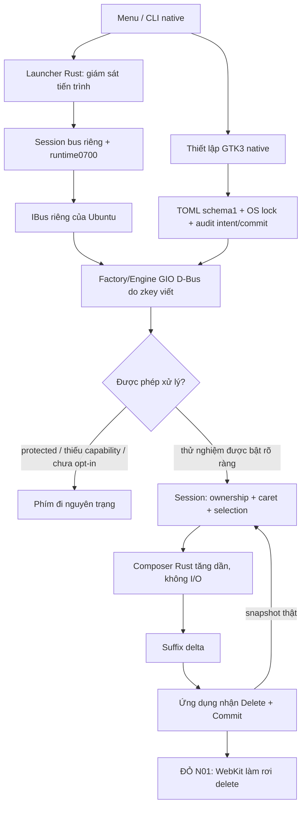

# zkey native — thiết kế, nghiệm thu và chặn phát hành

**16/11/2026 · bản viết mới theo Hà · DEVELOPMENT, CHƯA BÀN GIAO SẢN PHẨM CUỐI.**

Phạm vi: Rust + thư viện chuẩn, không crate ngoài, không nhập engine Python hoặc liên kết `zkey-core` cũ. Không đồng nhất điều đó với «không có phụ thuộc Ubuntu»: hệ thống vẫn cung cấp GLib/GIO/IBus/GTK, D-Bus và cơ chế nhập của ứng dụng. Bản cũ và toàn bộ diff bàn giao được giữ, không cài hoặc đổi IME desktop.

## Thiết kế đang có trong mã

Sơ đồ trên mô tả kiến trúc, **không thay bản đồ phụ thuộc máy đọc được**. `scripts/impact.py` trích module/import/include, source build và test, giữ fallback toàn bộ khi không chọn được kiểm. Trace Python bao gồm tooling native; vết IBus/ảnh UI xác nhận binary native thực nhận phím. Cạnh thư viện/compositor hệ thống chưa được coi là đã phủ hết bằng unit test.

### Đường phím và dữ liệu

1. Backend nhận keyval/state; modifier và release không bị đổi thành chữ. Ctrl nhấn-nhả đứng riêng đóng băng từ hiện tại.
2. PASSWORD/PIN/TERMINAL/private hints phải bypass; chưa nhận ContentType lần đầu cũng bypass. Khi rời ô nhập, bỏ buffer và đóng trạng thái. IBus có cache ContentType cấp engine, không bảo đảm gửi lại giá trị không đổi theo mỗi context ID: không được giả vờ nhận ra bí mật mà ứng dụng không khai báo.
3. Session chỉ sửa suffix của từ do chính nó đã commit, khi snapshot ứng dụng khớp nội dung/caret/selection/ranh giới. Không dùng cache sửa lạc quan của libibus làm ACK.
4. Composer quản lý chữ/dấu tăng dần; UTF-8 chỉ ở biên. Backspace do ứng dụng thực hiện. Nếu GTK gửi Reset sau phím này, chỉ ticket một lần có vị trí/nội dung được snapshot mới xác nhận mới cho tiếp tục đặt dấu. Đổi focus/shortcut/caret khác làm mất ticket.
5. Delete+commit của IBus **không nguyên tử và không có kết quả sửa tại editor**. Ownership trước edit không chứng minh delete sẽ được nhận. Vì vậy rewrite chưa được bật mặc định; không lấy đây làm cơ chế atomic đã giải quyết.
6. Runtime/key handler không ghi nội dung. Trace thử chỉ có trạng thái/counters và hash nguồn. Screenshot/bộ kiểm chỉ dùng dữ liệu giả trên Xvfb riêng; không đọc clipboard, không `/dev/input`, không giả Backspace.

### Thiết lập, lỗi và lưu bền vững

- Local Unix user là chủ cấu hình, không có endpoint mạng/tài khoản quản trị web mới. File cấu hình/audit tạo0600, runtime0700; OS kiểm quyền ghi.
- Schema nhỏ, rõ phiên bản; từ chối khoá lạ/trùng, kiểu sai, giới hạn sai. Chưa triển khai parser TOML đầy đủ.
- Lưu: validate → khoá file của OS → fsync audit-intent → file tạm+fsync → rename → fsync thư mục → audit-commit+fsync. Nếu lỗi sau rename, UI báo **đã đổi nhưng chưa xác nhận bền vững**, không báo sai «chưa lưu».
- Khi mở lại, generation thiếu audit commit bị coi là lỗi. Màn vẫn mở với mặc định và cảnh báo; chỉ nút Lưu mới ghi. Reload lỗi trong engine chuyển sang bypass, không giữ ngầm quyết định enabled cũ.
- Launcher giám sát daemon/engine. Mất dịch vụ thì hiện cảnh báo, không tự gõ lại hay restart mù. Lỗi khởi động từ menu có hộp thoại; CI trên private display bỏ hộp thoại có log, giữ mã thất bại. Không coi mã fork là kết quả.
- Bus và dịch vụ kích hoạt dùng runtime riêng cùng vòng đời. Dữ liệu phục hồi của ứng dụng không bị đặt vào cây sẽ tự xoá; runtime chỉ dọn sau khi bus dừng và hết mount riêng. Lỗi dọn phải đổi mã thoát; không ép unmount desktop.

## Điểm cần giữ ĐỎ / chưa chứng minh

| Mã | Loại | Bằng chứng / ranh giới |
|---|---|---|
| **N01** | **ĐỎ — chặn phát hành** | Engine Rust mới gõ WebKit thật vẫn `tiee → tieê`, cần `tiê`; `native/tests/accept_desktop.py` với `ZKEY_NATIVE_WEBKIT=1`, mã1. Viết lại core/adapter không bù được callback delete bị rơi tại frontend. Không cài interpose hoặc sửa thư viện hệ thống. |
| **N02** | Chưa có bảo đảm giao dịch | IBus gửi delete và commit riêng, không ACK nguyên tử. Không retry/rollback mù; không tuyên bố chờ snapshot là tự giải quyết mọi race. Cần frontend hợp tác hoặc đường sửa đã nghiệm thu; default bypass chưa phải hỗ trợ Telex. |
| **N03** | Chưa nghiệm thu desktop | GTK3/GTK4 trên Xvfb/X11 không thay Wayland-native/GNOME thật, Chrome/Electron/Firefox. Không tự đổi engine hay restart IBus để lấp chỗ trống này. |
| **N04** | Chưa thay backend terminal | Chưa có plugin shell native, vim/TUI/zsh/SSH. Bypass terminal không đồng nghĩa gõ tiếng Việt trong terminal. Không dùng plugin cũ làm bằng chứng cho bản mới. |
| **N05** | Chưa có đối chiếu độ mượt | Không có keyboard→pixel A/B với bộ gõ hiện tại/Windows. Unit, hash artifact, microbenchmark và thời gian chờ của bộ kiểm không chứng minh mượt hơn. |
| **N06** | Phạm vi ngôn ngữ còn giới hạn | Telex/NFC và tone style có kiểm; chưa có corpus ngôn ngữ đầy đủ, VNI, cam kết tiếng Anh tự giữ nguyên hay mọi grapheme tổ hợp. Ctrl freeze/Escape là cơ chế rõ ràng, không đoán ý người gõ. |
| **N07** | Đóng gói chưa phải cài/nghiệm thu hệ thống | Gói local có source, manifest và source hash nhúng; không IBus component/postinst. Chưa cài menu, chưa bật toàn hệ thống; cần gate phát hành còn ĐỎ vì N01–N05. |

Không hạ tiêu chí «nhận từng phím, không mất/nhân chữ» thành giữ từ trong preedit, clipboard hoặc Backspace giả chỉ để làm kiểm xanh. Không tuyên bố đã viết xong mọi ứng dụng Ubuntu khi các hàng trên còn treo.

## Đã đo trong lượt phát triển này

- Core/state: RED7/9 ở bộ Telex đầu tiên → GREEN; kiểm thêm Unicode, ownership, protected, giới hạn, audit, D-Bus types, IPC guard và protocol bounded. Số lượt cuối ghi trong sổ/đầu ra lệnh, không suy ra từ số file.
- Native GTK3: phím XTest thật, 7 tiền tố, câu, Backspace, password giả không đổi, không preedit nhìn thấy. GTK password có thể bỏ hẳn IM context: không khẳng định engine nhận purpose8 nếu trace không có; kiểm focus-out đóng context và UI thực tế.
- Native GTK4/X11: flow chữ/password đã chạy; lượt đầu có cảnh báo EGL/deprecated API của harness. Không lấy lượt đó làm «0 warning». Harness mới dùng Xlib public pin PID/window, software rendering trên Xvfb; cần đọc lượt chạy lại, không xoá lịch sử cảnh báo.
- Thiết lập hai vai: nút UI → TOML/audit → mở lại giữ lựa chọn → ô gõ thật `hoà → hòa`. Lỗi `gtk_main_quit` gọi hai lần khi đóng màn: bài UI ĐỎ vì Gtk-CRITICAL → thêm kiểm main-loop level → lượt sau hết lỗi; giữ làm regression.
- Launcher Rust tự mở bus/IBus/native engine: 15/15 lượt gõ dồn0ms đã đạt, không dùng runtime Python. Ca `tiếng + Backspace + f` ban đầu ra `tiếnf`: trace Reset của GTK → ticket có xác nhận → UI đạt `tiền`. Kiểm này giữ ở `native/tests/accept_launcher.py`.
- Native WebKit rewrite **vẫn ĐỎ**; safe-mode native WebKit giữ nguyên phím và không nhân chữ nhưng **không Telex**. Không tính bypass là sửa N01.

### Lượt kiểm bản hiện tại (16/11, trước đóng gói thử)

- Rust native **36/36**, clippy `-D warnings` mã0, release mã0. Bản đồ trích **204 nút/127 kiểm**, ghi trace chạy **80 kiểm Python** (74 cũ +6 packaging native), không phải đã chạy127 kiểm bằng lệnh đó.
- GTK3 + GTK4 trên X11/Xvfb: mỗi frontend **15/15** lượt burst0ms có Backspace; password giả giữ nguyên, không preedit. Thiết lập: trạng thái lỗi/lưu/mở lại và hộp thoại khởi động lỗi+exit1 đã bấm thật.
- Launcher Rust: **15/15** burst0ms; Ctrl freeze rồi Escape giữ `âs`; VTE ECHO-off không lộ/không đổi dữ liệu giả. Tắt `ActiveSurroundingText` eager-request để chỉ hỏi sau capability/content gates: bài VTE từĐỎ vì warning sang0warning.
- Lỗi cấu hình giữa lúc chạy: engine còn sống nhưng bypass nay có **hộp thoại nhìn thấy** từ supervisor; sửa bằng màn thiết lập rồi gõ lại Telex đạt. Ca này từng KHÔNG ĐO ĐƯỢC vì socket AT-SPI quá dài/bridge bị tắt; runtime đổi tên ngắn và bật accessibility của hộp thoại, không bỏ kiểm UI.
- Ca engine chết cùng app đóng: regression child-process thật **RED→GREEN**, kiểm liveness sau khi đã thấy app exit trước khi trả thành công. UI acceptance đối chiếu hash **nguồn hiện tại độc lập**, không chỉ tự so binary với trace của chính nó. Staging cấy lệch bản sao source/binary phải bị từ chối, giữ `.STAGING`.
- Purpose chưa nhận và purpose **ngoài enum đã biết** là hai ca riêng: test cũ chỉ kiểm chưa nhận metadata. Bài mới gửi11/99/u32MAX từngĐỎ; engine nay chỉ cho purpose0–7 xử lý, purpose còn lại và private hints bypass; regression xanh. Đây không chứng nhận mọi client tự khai đúng bí mật.
- **QG chung vẫnĐỎ1**, không được gọi sẵn sàng phát hành: baseline `src/bin/line.rs`/`src/telex.rs` cũ không theo rustfmt, cây chưa commit, regex secrets nhận nhầm biến `password`/synthetic `aas` ở bộ kiểm. Không tự sửa phần cũ hoặc miễn trừ gate để lấy xanh. Native fmt riêng đạt; rào release thật vẫnN01–N07.

### Gate nghiệm thu sản phẩm — verdict: CHƯA XONG

| Chiều | Trạng thái | Bằng chứng / phần thiếu |
|---|---|---|
| Build/lint/tests native | ĐẠT trong phạm vi native | Các số và lệnh nêu trên; không coi QG gốc là xanh |
| UI/dữ liệu/config | ĐẠT ở các flow Xvfb đã nêu | XTest thật → TOML/audit → mở lại → typing; ảnh đã xem; fault recovery qua UI |
| Đối chứng/gói | ĐẠT ở kiểm local đã nêu | Wrong hash/mutated copy bị từ chối; không cài; gói vẫndevelopment |
| Chạy trên môi trường người dùng | **THIẾU/ĐỎ** | N01–N05; Xvfb không thay desktop Wayland/browser/keyboard→pixel |
| An toàn/security | Chưa đủ để phát hành toàn hệ thống | Protected/unknown purpose, ownership, ABI, runtime riêng có kiểm; không cam kết client khai sai vẫn được bảo vệ |
| Contract/triển khai/git | Chưa phát hành | XML/native/config trong cùng cây stage; chưa commit/push/cài; QG chungĐỎ |
| Báo cáo/sổ | Có ghi cả đỏ và xanh | `TODO.md`, `memory/active-context.md`, `logs/devlog.md`; không nhận bypass là Telex |

### Ảnh từ UI thật (private Xvfb, dữ liệu giả)

- [Thiết lập lỗi](../.tmp/native-settings-error.png), [sau lưu](../.tmp/native-settings-saved.png), [mở lại](../.tmp/native-settings-reopened.png).
- [Launcher/ô gõ](../.tmp/native-launcher.png).
- [Lỗi cấu hình khi đang chạy](../.tmp/native-runtime-settings-error.png), [sửa bằng UI và gõ lại](../.tmp/native-runtime-settings-recovered.png), [VTE không lộ mật khẩu giả](../.tmp/native-terminal-secret.png).
- [WebKit đang lỗi](../.tmp/native-webkit-failed.png), [WebKit bypass](../.tmp/native-webkit-safe.png).

## Kiểm và đóng gói chạy lại

Các lệnh build/test ở `native/README.md`. Native UI entrypoint `accept_launcher.py` tự chạy **launcher Rust thật**; `accept_desktop.py` cô lập daemon để tách frontend. Tất cả yêu cầu `ZKEY_TEST_DISPLAY` của Xvfb riêng. Controller Python chỉ là dụng cụ kiểm; chương trình đóng gói không cần Python/GI.

`native/tools/stage.py` chỉ tạo cây mới dưới `.tmp`, đối chiếu SHA-256 nguồn với `--build-info` của binary, đo GLIBC từ ELF, kèm source/giấy phép/manifest, tạo `.deb` local nếu yêu cầu. Không overwrite cây/tệp có sẵn; không install/publish. Hash sai phải ĐỎ, hash đúng mới qua. Chuẩn bị gói không đóng N01–N07 và không đồng nghĩa đã bàn giao sản phẩm cuối.
